# Minecraft at Home

**Tyler Beck** · Intro to Computer Graphics (CS 5160) · Project 2: Cube World · University of Cincinnati, Fall 2026

- **Live app:** https://tbeck561.github.io/project2-Graphics/
- **Source code:** https://github.com/tbeck561/project2-Graphics

## Overview

It's a small blocky world that runs in the browser. I built it with plain JavaScript and WebGL. The only model in the whole project is one 2×2×2 cube. All the ground, the clouds, the blimp and the birds are that same cube, just translated, scaled and rotated into place with 4×4 matrices.

The ground heights and colors come from two images, a grayscale height map and a color map. The blimp and birds fly along Bézier curves. I split the app into levels so you can click through and see the world get built up one concept at a time.

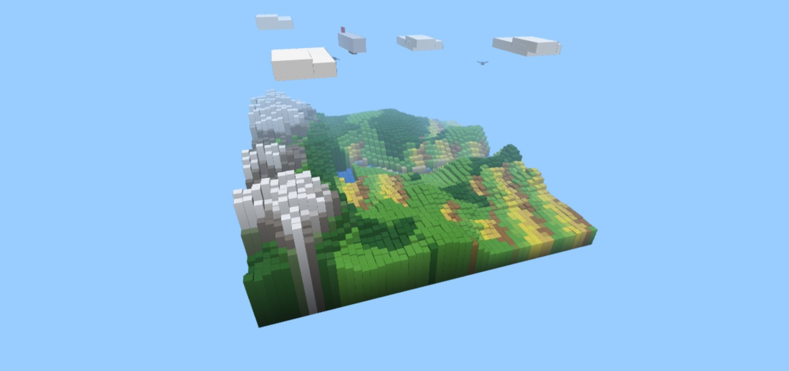
*The finished world in Level 4.*

## Design

### Sketch

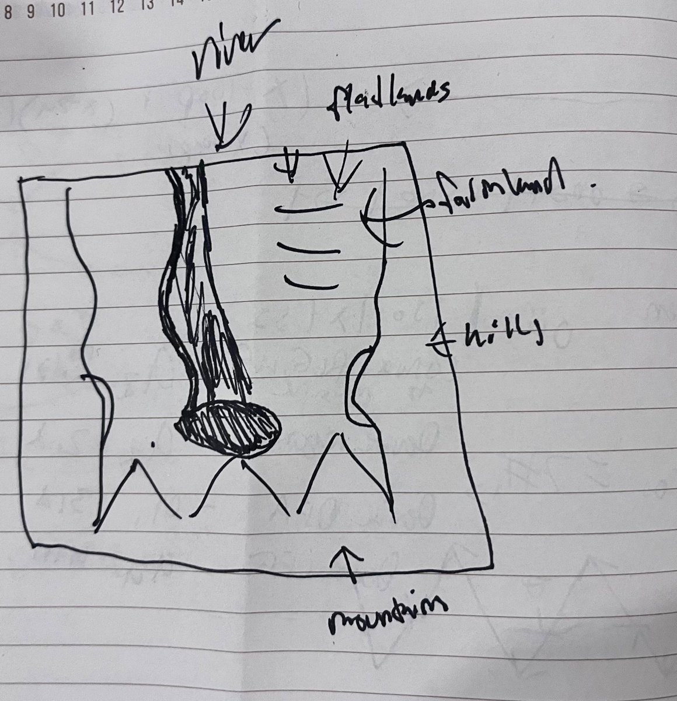
*My original sketch.*

### What I was going for

I wanted it to look like a Minecraft knockoff. The plan was one square chunk of land floating in the sky:

- **River:** comes in from the top edge and runs down into a lake.
- **Flatlands and farmland:** on the right side next to the river, with patchy fields.
- **Hills:** along the sides.
- **Mountains:** a row of snowy peaks along the bottom edge, right behind the lake.
- **Sky:** blocky clouds, a blimp and some birds flying around above it.

I also wanted every block to be easy to see, with the grass-on-dirt look where the top is colored and the sides fade to brown.

### How it should feel

You click through the levels with buttons at the top. Each one adds one thing: one cube, then a flat grid, then heights, then colors, then a moving camera, then the world from the images, then the sky, then lighting. The camera slowly spins around the world so you can see it from every side without doing anything. There's also a menu to change how many cubes are in the grid.

## Features and controls

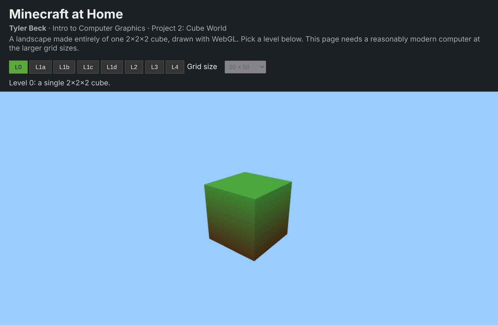
*The interface.*

| Control | What it does |
|---|---|
| **L0 to L4 buttons** | Switch between the levels. Each one shows a line explaining what it's showing. |
| **Grid size** | How many cubes go along each side: 10, 25, 50 (the default), 100 or 150. 150 × 150 is 22,500 cubes and 810,000 vertices, so the header says bigger sizes need a decent computer. |
| **Camera** | Stays still for Levels 0 to 1c, then spins around the center on its own from Level 1d on. |

## How it works

I split the code into one file for each part:

| File | What it does |
|---|---|
| `math.js` | All the matrix math, written by hand: identity, multiply, translate, scale, rotate, perspective, lookAt. |
| `cube.js` | The cube model: 36 vertices with a normal for each face. |
| `webgl.js` | The vertex and fragment shaders, plus helpers that send data to the GPU and draw it. |
| `landscape.js` | The grid of cubes, the height and color procedures, and the image sampling. |
| `sky.js` | The Bézier function plus the clouds, blimp and birds. |
| `main.js` | The level buttons, the camera and the animation loop. |

Every frame goes through the same graphics pipeline we covered in class:

1. **Vertices.** The cube corners sit in GPU buffers, and each one also has a color and a normal.
2. **Vertex shader.** Each vertex gets multiplied by `Projection · View · Model`. That takes it from the cube's own space into the world, then to the camera's point of view, then onto the screen.
3. **Rasterization.** The GPU fills in each triangle, figures out which pixels it covers, and blends the vertex values like color across it.
4. **Fragment shader.** This picks the final color of every pixel and adds the shading, lighting and fog.
5. **Depth test.** `gl.enable(gl.DEPTH_TEST)` keeps the closest surface at each pixel, so cubes in front hide the ones behind them. That's the z-buffer doing hidden surface removal.

## Level walkthrough

### Level 0: one cube

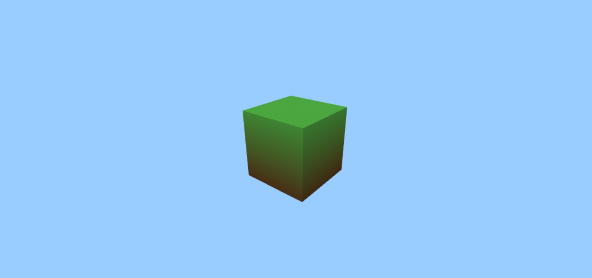

This is the only model in the project: a 2×2×2 cube centered at the origin, so every corner is at ±1. A cube only has 8 corners, but it's drawn as 6 faces × 2 triangles × 3 vertices = **36 vertices**. The corners get repeated because each face needs its own normal for shading.

```js
// top face with its normal and four corners
[[0, 1, 0], [[-1, 1, 1], [1, 1, 1], [1, 1, -1], [-1, 1, -1]]],
...
// split every face into two triangles
for (const i of [0, 1, 2, 0, 2, 3]) CUBE.push({ pos: c[i], normal });
```

**Course concept:** 3D objects as vertices, edges and triangles. The GPU can only draw triangles, so even a cube is just a list of 12 of them.

### Level 1a: a grid of cubes (translation)

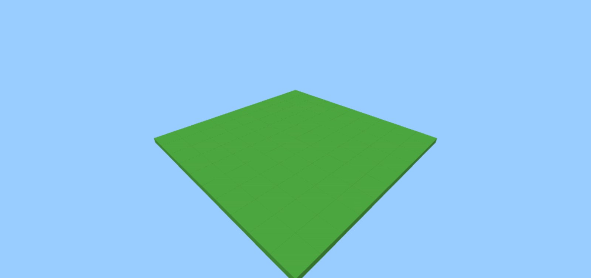
*10 × 10 grid*

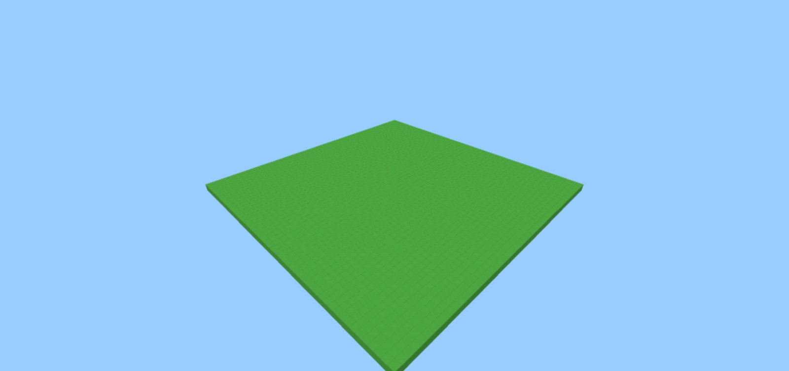
*50 × 50 grid*

The landscape goes from −20 to 20 in x and z. With N cubes on a side, each cell is `40 / N` wide, and cube (i, j) gets moved to the middle of its cell:

```js
const x = -SIZE / 2 + (i + 0.5) * cell;
const z = -SIZE / 2 + (j + 0.5) * cell;
```

**Performance:** drawing every cube with its own draw call would be slow. So I apply each cube's matrix to its 36 vertices in JavaScript and put all the cubes into one big buffer. Then the whole landscape is **one draw call**, which keeps even the 150 × 150 grid (22,500 cubes) usable. It only rebuilds when you change the level or the grid size.

**Course concept:** translation as a 4×4 matrix. In homogeneous coordinates a point is (x, y, z, 1), and the translation sits in the last column of the matrix.

### Level 1b: heights (scaling)

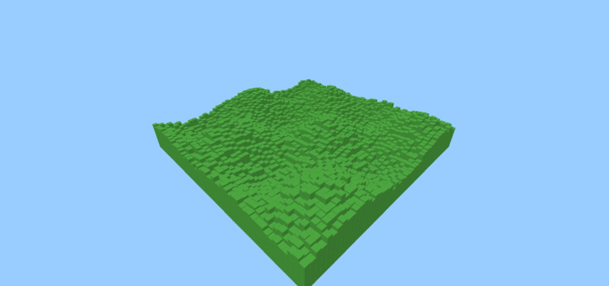

Each cube gets scaled in y, which is the direction straight up from the x-z plane. The heights come from a simple formula: sine waves for rolling hills plus a random number so it's bumpy.

```js
h = 4 + 3 * Math.sin(x * 0.3) * Math.cos(z * 0.25) + Math.random();
const model = multiply(translate(x, h / 2, z), scale(cell / 2, h / 2, cell / 2));
```

The **order matters** here. The cube gets scaled first to cell × h × cell. The scale factor is half the size because the cube is 2 units wide. Then it gets moved up by `h / 2` so the bottom sits on y = 0 instead of being half underground.

**Course concept:** scaling and combining transformations. `Model = Translate · Scale` reads right to left, so it scales first and then moves.

### Level 1c: vertex colors

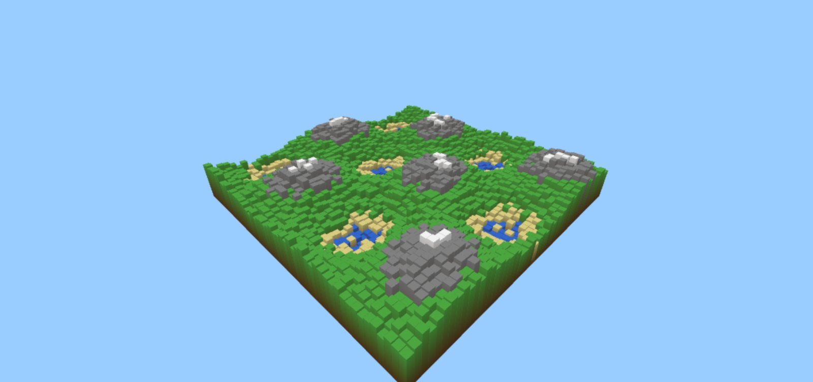

A little function picks a color for the **top vertices** of each cube based on how tall it is: water under 2, then sand, grass, rock, and snow over 7.5. The **bottom vertices** are always dirt brown.

```js
colors.push(...(v.pos[1] > 0 ? top : bottom));
```

I never set a color for the sides, but every side still fades smoothly from the top color down to brown. That comes from the rasterizer. When it fills in a triangle, it **interpolates** the vertex colors across it (barycentric interpolation), and the fragment shader gets the blended color for each pixel.

**Course concept:** triangle rasterization and interpolating values between vertices.

### Level 1d: the camera spins around

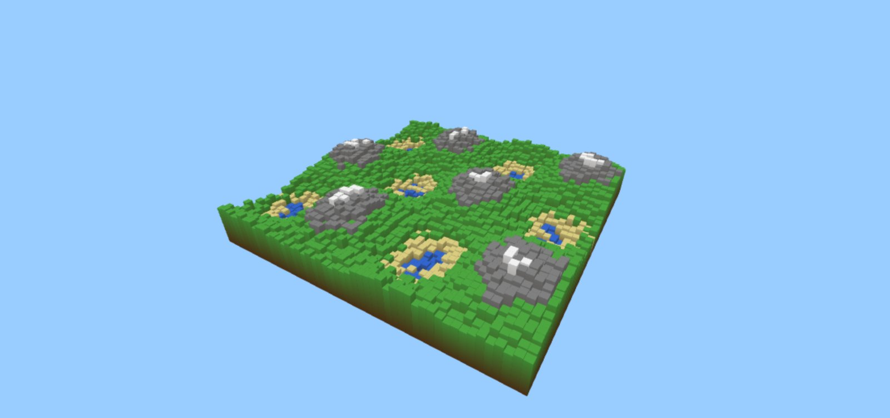

The camera moves in a circle with a radius of 45 at a height of 28, and it always looks at the center, (0, 0, 0):

```js
const angle = time * 0.2;
eye = [45 * Math.cos(angle), 28, 45 * Math.sin(angle)];
lookAt(eye, [0, 0, 0], [0, 1, 0]);
```

`lookAt` builds the **view matrix**. It works out the camera's three axes (backward = eye − target, right = up × backward, up = backward × right). Then it moves the whole world so the camera is at the origin looking down −z. After that, the **perspective matrix** (60° field of view) divides by depth so far-away cubes look smaller. That's the pinhole camera model: every point gets projected through one point onto the image plane.

**Course concept:** viewing, which covers the pinhole camera, the look-at transform and perspective projection.

### Level 2: the world from images

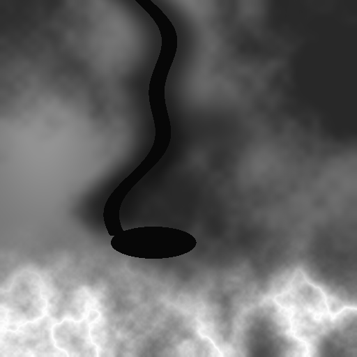
*Height map (512 × 512, grayscale)*

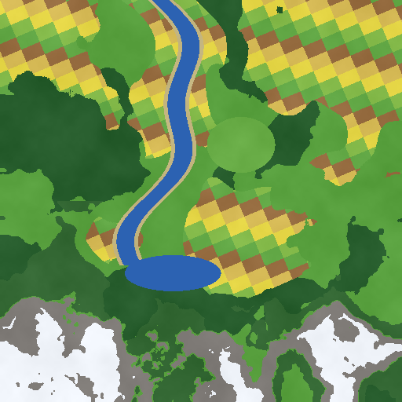
*Color map (512 × 512)*

The terrain comes from two 512 × 512 images, and the layout matches my sketch. The height map is all grayscale, so black is low and white is high. The color map gives each spot its color.

**Picking a color when the image is bigger than the grid.** At 50 × 50, each cube covers about a 10 × 10 patch of pixels. Instead of grabbing one pixel, I shrink the whole image down to N × N on a hidden canvas and read that:

```js
ctx.drawImage(img, 0, 0, N, N);
return ctx.getImageData(0, 0, N, N).data;
```

When the browser shrinks an image, it blends nearby pixels together instead of just picking one. So each cube gets a color that represents its whole patch. That stops thin stuff like the river from disappearing or flickering, which can happen if you only read the one pixel in the middle (aliasing).

**Turning gray into height.** The gray value goes from 0 to 255. Dividing by 255 gives 0 to 1, and then I scale that to world units:

```js
h = 0.5 + (heightData[k] / 255) * 12;   // 0.5 to 12.5
```

The 0.5 minimum makes sure no cube is totally flat. The bottom color of each cube is a darker copy of its top color, so the grass-to-dirt fade from Level 1c still shows up.

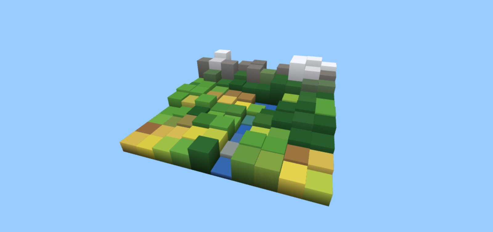
*10 × 10*

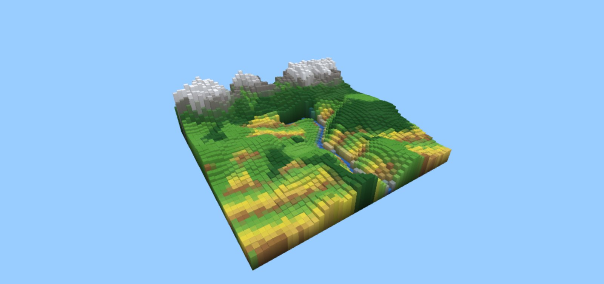
*50 × 50 (the default)*

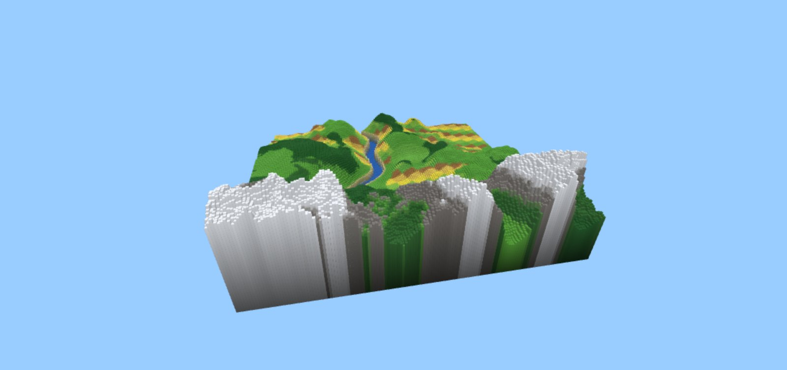
*150 × 150*

It starts at 50 × 50, which should run fine on most laptops, and you can go up to 150 × 150 with the menu.

**Course concept:** sampling, which means fitting a big image onto a smaller grid and turning pixel values into real heights.

### Level 3: the sky

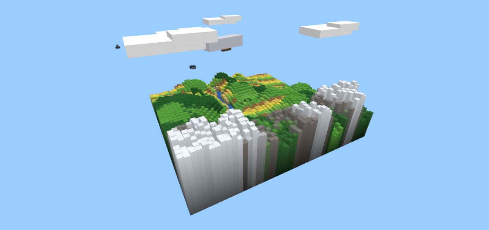

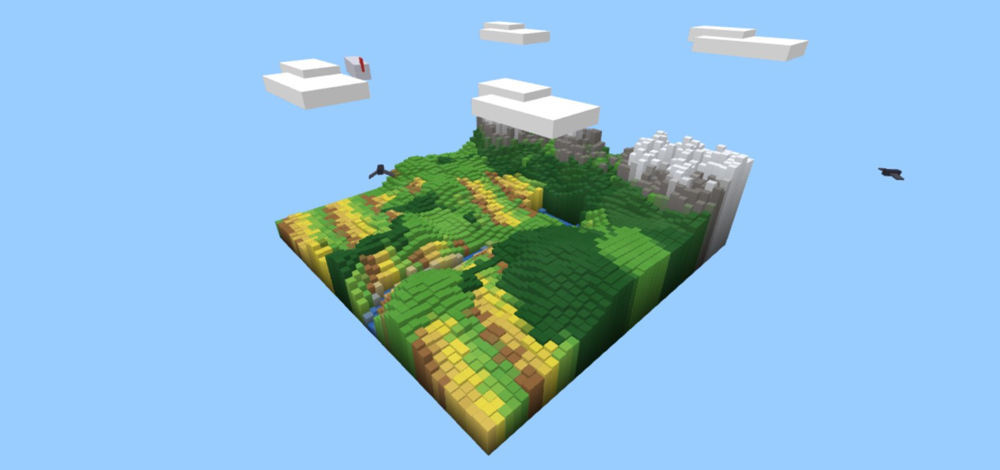

Everything in the sky is made from the same cube using **hierarchical transforms**. Each object has a parent matrix for where it is and which way it's facing, and each part multiplies its own transform onto that:

```js
function cube(parent, x, y, z, w, h, d, color) {
  drawMesh(unitCube, multiply(parent, multiply(translate(x, y, z), scale(w / 2, h / 2, d / 2))), color);
}
```

- **Clouds:** two flat white cubes each, moved and stretched into place. They don't move.
- **Blimp:** a body, a red tail fin and a gondola, all inside the blimp's parent matrix. It flies along a Bézier curve and turns around y to face the way it's going.
- **Birds:** a body and two wings. Each wing rotates around the x axis by `sin(time)`, so they flap.

The sky objects all use one white cube, and a `uTint` uniform in the fragment shader colors each part.

**Course concept:** rotation matrices and stacking transforms into a hierarchy, where world = parent · part.

### Level 4: lighting and fog


**Sun lighting.** The brightness of each pixel depends on the angle between its surface normal and a fixed sun direction. That's Lambert's cosine law. I also add some ambient light so the shady sides aren't pitch black:

```glsl
shade = 0.35 + 0.75 * max(dot(n, sun), 0.0);
```

Slopes facing the sun are bright and slopes facing away are darker, which makes the mountains and valleys way easier to see. Before Level 4, each side of a cube just gets a set brightness.

**Fog.** The fragment shader checks how far each pixel is from the camera and fades it toward the sky color between 30 and 95 units away, which gives it more depth:

```glsl
float fog = smoothstep(30.0, 95.0, length(vWorld - uCamera));
color = mix(color, uSky, fog);
```

**Course concept:** shading and lighting, using surface normals, Lambert diffuse light and ambient light, all done per pixel in the fragment shader.

## The Bézier curve function

The blimp and birds use a **cubic Bézier curve**. That means four control points, P0 to P3, and a value t that goes from 0 to 1:

```
B(t) = (1−t)³·P0 + 3(1−t)²t·P1 + 3(1−t)t²·P2 + t³·P3
```

The four weights are the cubic Bernstein polynomials. They always add up to 1, so B(t) is a mix of the control points. The curve starts at P0 when t = 0 and ends at P3 when t = 1. P1 and P2 pull the curve toward them, but it doesn't actually go through them.

```js
function bezier(P, t) {
  const u = 1 - t;
  const w = [u * u * u, 3 * u * u * t, 3 * u * t * t, t * t * t];
  return [0, 1, 2].map((k) => w[0] * P[0][k] + w[1] * P[1][k] + w[2] * P[2][k] + w[3] * P[3][k]);
}
```

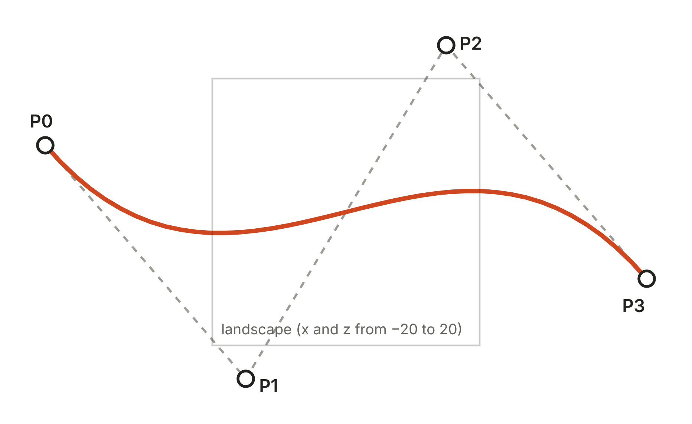
*The blimp's path seen from above (x goes across, z goes down). The dashed line is the control polygon and the orange curve is where the blimp actually flies. P0 and P3 are outside the landscape.*

| Object | Control points (x, y, z) | Time per trip |
|---|---|---|
| Blimp | (−45, 18, −10), (−15, 26, 25), (15, 12, −25), (45, 20, 10) | 25 s |
| Bird 1 | (−40, 14, 20), (−10, 22, −20), (10, 8, 30), (40, 16, −15) | 12 s |
| Bird 2 | (35, 15, 30), (10, 24, 0), (−5, 10, −35), (−40, 18, −20) | 12 s, half a trip behind bird 1 |

**Moving and starting over.** Every frame, t is the time divided by how long the trip takes, and it wraps back to 0 once it hits 1:

```js
followPath(BLIMP_PATH, (time / 25) % 1);
```

Since P0 and P3 are off the edges of the landscape, each object starts and ends its trip far away. When t wraps from 1 back to 0, it disappears at the far end and starts over from where it began.

**Facing forward.** To point the blimp the way it's moving, I also check the curve a little bit ahead, at t + 0.01. The direction between those two points is basically the tangent of the curve, and `atan2` turns it into a rotation around y.

## Future work

### What I'd do next

- **Skybox and day/night:** a giant cube around the camera with a sky gradient, plus a sun that moves and changes the light color.
- **Camera controls:** click and drag to rotate and scroll to zoom, not just the automatic spin.
- **Bigger grids:** GPU instancing, where the GPU places each cube from a small list instead of me building every vertex, so 300 × 300 or bigger would still run smooth.
- **Bézier terrain:** shape the hills with Bézier surfaces instead of an image.
- **Textures:** actual pixel-art textures on the blocks so it looks more like Minecraft.

## AI use

I used Claude, Anthropic's AI assistant, for this project:

- **Code:** Claude wrote the base template for the project and helped organize the problems that I solved based on the class material. Anyquestions I had I asked AI for assistance solving too.
- **Images:** the height map and color map came from a Python script Claude wrote based on a drawing I made.
- **Documentation:** Claude drafted this page and i wrote 


